<p align="center">
  
</p>

<h1 align="center">reel-factory</h1>

<p align="center">
  <b>A Claude Code plugin that turns a topic, or nothing at all, into a finished Instagram Reel.</b><br>
  Research → creation mode → script → voice, music and visuals → render → QA. One command.
</p>

<p align="center">
  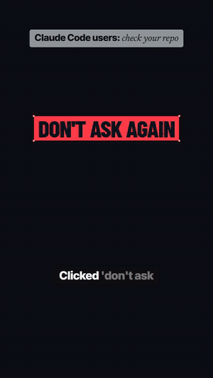
  <br><sub>The opening of a reel reel-factory produced end to end from trend discovery, shown in the <code>ink</code> theme. No manual edits.</sub>
</p>

```text
/reel                     trend discovery: finds today's best AI/tech topic from live data and produces it
/reel <topic or URL>      produces a reel about your topic
/reel <topic> --mode ai   skip the mode question and let the Creative Director decide
/reel-trends [niche]      just show the top trending topics with evidence
/reel-learn <folder>      learn from your reference reels: dedup, analyse, evolve modes and techniques
/reel-setup               first-run onboarding: probe this machine, install the runtime, set preferences
```

## Ten ways to build a reel

Every topic gets the full table of creation modes with a line about what *that topic* would look like in each one, a ★ recommendation, and an **AI Select** option. The modes differ in construction: what's on stage, who presents, where the visuals come from, whether there's a voice, how fast it cuts and how it sounds.

<table>
  <tr>
    <td align="center">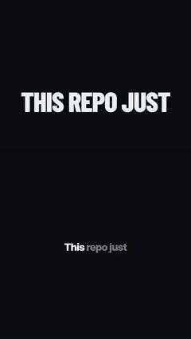<br><b>Kinetic Explainer</b><br><sub>faceless motion graphics,<br>one composition per sentence</sub></td>
    <td align="center">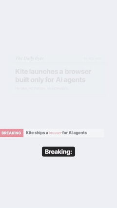<br><b>Newsroom Brief</b><br><sub>BREAKING banner, headlines<br>highlighted as they're read</sub></td>
    <td align="center">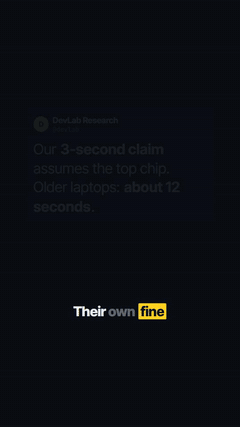<br><b>Receipts</b><br><sub>primary sources highlighted<br>line by line → verdict</sub></td>
    <td align="center">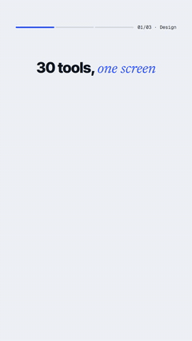<br><b>Rapid Catalog</b><br><sub>i/N carousel, progress,<br>cheat-sheet end frame</sub></td>
  </tr>
  <tr>
    <td align="center">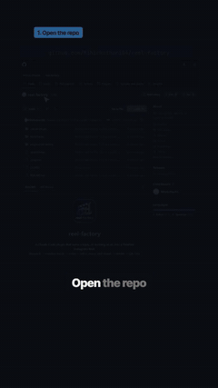<br><b>Screen Walkthrough</b><br><sub>cursor types, points and zooms<br>(shown on this repo's own page)</sub></td>
    <td align="center">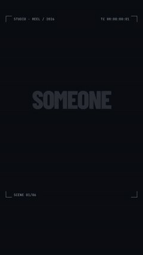<br><b>Cinematic Hype</b><br><sub>film-slate HUD, accent slabs,<br>cuts every ~0.8 s</sub></td>
    <td align="center">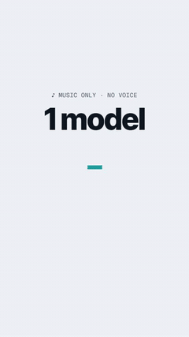<br><b>Silent Showcase</b><br><sub>no voice: huge text cut<br>on the music's beat</sub></td>
    <td align="center"><br><b>Illustrated Story</b><br><sub>a character fails and learns,<br>chapter by chapter</sub></td>
  </tr>
</table>

Plus **Presenter + Board** (your own recorded clip, or an AI avatar, under a motion-graphics board) and **Quick Take** (a headline sticker over the source itself, made the same day). Mode playbooks live in [`references/modes/`](plugins/reel-factory/skills/reel-factory/references/modes/INDEX.md).

<sub>The mode demos above are rendered by the plugin's own engine. The walkthrough uses screenshots of this repository; the others use fictional example content.</sub>

## How it works

<p align="center">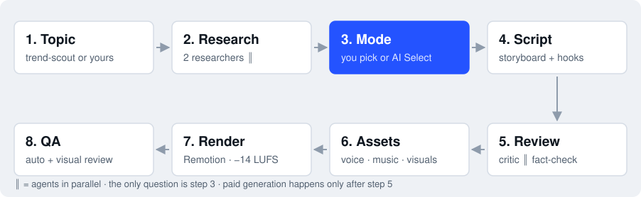</p>

- **Multi-agent where it pays off:** two researchers work in parallel (primary sources, and reception plus fresh angles); a script critic and a fact-checker review in parallel before any credits are spent; a QA reviewer actually looks at the rendered frames.
- **Built on evidence, not vibes:** the rules come from a frame-by-frame study of 105 AI and tech reels: voice on frame one, ~200 wpm, a visual change every 1.5–3 s, −14 LUFS, a music bed ~10 dB under the voice, a re-hook at 40–60%, and a CTA that *shows* the action.
- **Voice-locked editing:** scene cuts, list reveals, highlighter sweeps, cursor clicks and carousel cards all land on the exact word that names them.
- **Truthful by default:** every claim maps to a source, numbers are fetched live (GitHub stars and the like), and the plugin never generates real people's likenesses or fake quotes.

## It adapts to your machine

Not everyone has a GPU or an ElevenLabs account. Before anything runs, a probe checks the system and builds a plan from what's actually there. It asks only for what's missing and works with the rest:

<p align="center">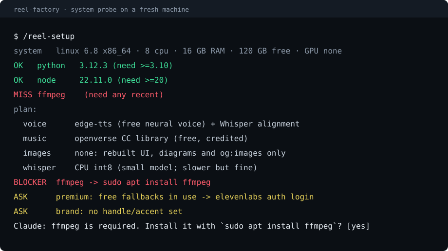</p>

| If you have | It uses | Without it |
|---|---|---|
| ElevenLabs (CLI login or `ELEVENLABS_API_KEY`) | premium voice with exact timestamps, custom music, generated images and video | edge-tts neural voice, Openverse CC music, rebuilt UI and diagrams |
| An NVIDIA GPU | Whisper on CUDA | Whisper on CPU (a smaller model on low-RAM machines) |
| Your own talking-head clip | Presenter mode with your face | faceless modes |
| `agent-browser` + opt-in | real page captures | APIs, og:images, rebuilt UI |
| Missing Python, Node or ffmpeg | | it stops, prints the install command for your OS and offers to run it (with your permission) |

## Quality control you can see

Every render is re-measured the way the reference reels were measured (loudness, pace, cadence, black and frozen frames, Whisper intelligibility), then reviewed visually from a contact sheet:

<p align="center">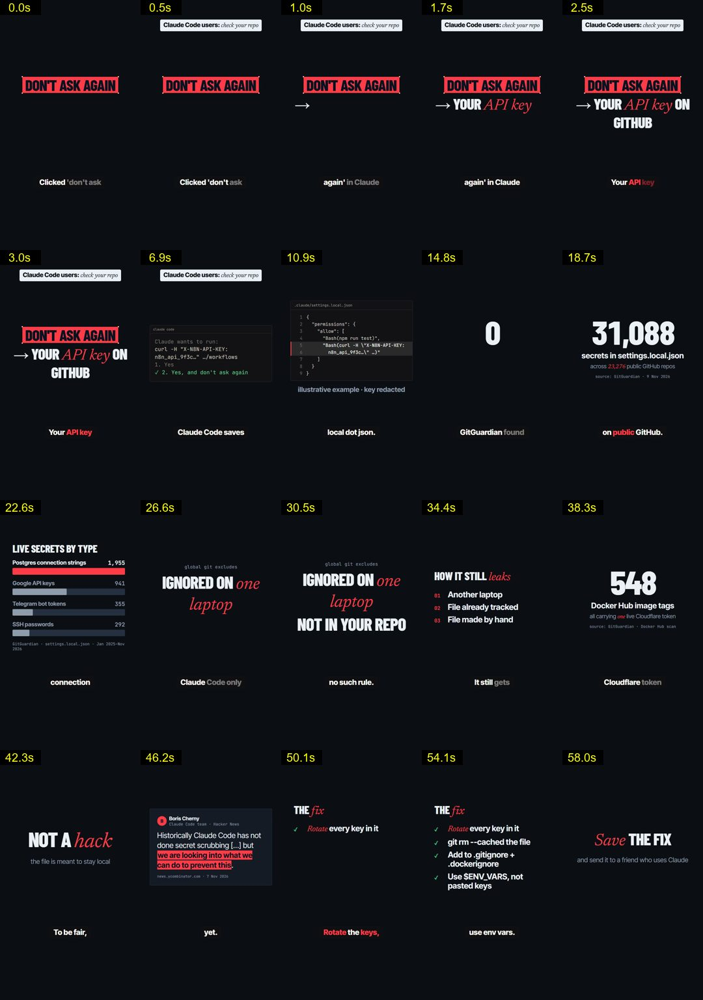</p>

## Install

```bash
claude plugin marketplace add Mihirkothari04/reel-factory
claude plugin install reel-factory@reel-factory --scope user
```

Start a new Claude Code session and run `/reel-setup`.

**Requirements:** Claude Code, Python 3.10+, Node.js 20+ and ffmpeg (the probe tells you how to install anything missing). Optional: an NVIDIA GPU, [`uv`](https://github.com/astral-sh/uv), the [ElevenLabs CLI](https://www.npmjs.com/package/@elevenlabs/cli), and [`agent-browser`](https://www.npmjs.com/package/agent-browser). The runtime (~1.5 GB: Python venv, Remotion with headless Chromium, SFX kit, your config and lessons) lives in `~/.reel-factory/`, and plugin updates never touch it.

**Costs:** research, alignment, drafts and QA are free and local. With ElevenLabs a reel typically uses about 1,000–2,500 credits for voice and music; images, b-roll and avatars are budgeted and opt-in. Without ElevenLabs everything still runs on free providers.

## It keeps learning

Point `/reel-learn` at a folder of reels you admire. It fingerprints every video and skips duplicates (even re-encoded or trimmed copies), analyses only what's new with local tools, and compares each reel with the known modes, story skeletons and techniques. Then it adds what's genuinely new: a new mode, a new structure, or a better hook, annotation or audio trick. It implements the change in the engine when it's renderable, and versions the knowledge base.

Fork-friendly: a marketplace install is a cached copy that updates replace, so to evolve your own version, clone the repo and install it as a local marketplace:

```bash
git clone https://github.com/Mihirkothari04/reel-factory && cd reel-factory
claude plugin marketplace add .
claude plugin install reel-factory@reel-factory --scope user
```

## Responsible use

reel-factory won't fabricate quotes, numbers, comments or endorsements. It won't generate likenesses of real people, won't repost other creators' videos, and uses allegation language with cited outlets for news about people. Review every reel before you publish: you're responsible for what you post.

## License

[MIT](LICENSE)
